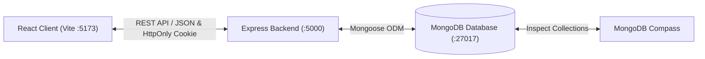

# 🎓 SkillSwap Campus — Student Skill Exchange Platform

> **Share What You Know. Learn What You Love.**  
> A full-stack web application empowering college students to trade skills, build portfolio projects, and collaborate peer-to-peer without paid courses or bootcamps.

---

## 📋 Table of Contents
1. [Overview & Features](#-overview--features)
2. [Technology Stack](#-technology-stack)
3. [System Architecture & Workflow](#-system-architecture--workflow)
4. [Prerequisites](#-prerequisites)
5. [Installation & Setup](#-installation--setup)
6. [Environment Variables](#-environment-variables)
7. [MongoDB & MongoDB Compass Guide](#-mongodb--mongodb-compass-guide)
8. [Database Models](#-database-models)
9. [API Endpoints Reference](#-api-endpoints-reference)
10. [Seed Data & Demo Accounts](#-seed-data--demo-accounts)
11. [Running the Application](#-running-the-application)
12. [Troubleshooting & Common Issues](#-troubleshooting--common-issues)
13. [License & Credits](#-license--credits)

---

## 🌟 Overview & Features

**SkillSwap Campus** connects college students who want to teach skills they already know and learn skills they need from their peers. For instance, a Computer Science student proficient in Python can match with a Graphic Design student proficient in Figma, swapping reciprocal 1-on-1 sessions.

### Key Features
- **Modern EdTech Design System**: Crafted with clean off-white backgrounds (`#f8fafc`), deep navy typography (`#0f172a`), vivid indigo/violet accents (`#4f46e5`), subtle drop shadows, and Lucide icons.
- **Secure Authentication**: Register and Login with hashed passwords (`bcryptjs`) and JWT stored in secure `HttpOnly` cookies and Authorization Bearer fallback.
- **Explore Skills Catalog**: Live search, category filtering (Programming, Design, Data & AI, Languages, etc.), skill level filtering, and type filtering (offered vs. wanted).
- **Skill Management**: Post new skill listings with detailed topics/syllabus, experience level, exchange mode (Campus In-Person, Online Zoom/Discord, Flexible), and availability schedule.
- **Student Profile**: Editable profile with bio, major, year of study, skills offered, skills wanted, and campus contact channels (Discord, College Email, Telegram).
- **Smart Matchmaking**: Dashboard algorithm that analyzes what you teach vs. what peers seek, highlighting reciprocal direct swaps.
- **Real Exchange Workflow**:
  - Send structured swap proposals specifying what you offer in return and proposed study times.
  - Owners receive requests and can **Accept** or **Decline**.
  - Senders can cancel pending requests.
  - When accepted, private contact information (Discord, Email, meeting locations) is unlocked for both students.
- **Responsive Layout**: Works seamlessly on mobile phones, tablets, and desktop displays.

---

## 💻 Technology Stack

### Frontend
- **React.js 18** with **Vite**
- **React Router v6** for client-side routing and protected routes
- **Lucide React** for consistent iconography
- **Vanilla CSS3** with design tokens / CSS variables (Plus Jakarta Sans & Inter typography)
- Reusable components (`Navbar`, `Footer`, `SkillCard`, `RequestCard`, `ExchangeModal`, `SkillDetailModal`, `ConfirmModal`, `Loader`, `EmptyState`, `Toast`)

### Backend
- **Node.js** (v18+)
- **Express.js** REST API
- **JSON Web Tokens (JWT)** for session validation
- **Cookie-Parser** for secure `HttpOnly` cookie handling
- **Bcryptjs** for password hashing
- **CORS** configured with credentials support
- **Morgan** for HTTP request logging

### Database
- **MongoDB** (Local Community Server or MongoDB Atlas)
- **Mongoose ODM** with schemas, validation, virtual aliases, and indexes

---

## 🏛 System Architecture & Workflow



### Skill Exchange Workflow
1. **Student A** lists a skill (e.g. *"Modern React.js & Web Dev"*).
2. **Student B** finds the listing and sends an exchange proposal offering *"Figma UI Design"*.
3. **Student A** reviews the incoming proposal on their Dashboard or Exchanges page.
4. If **Accepted**, both students unlock each other's contact information (Discord tag, meeting pod at Campus Library, or Zoom link) to begin their learning sessions!

---

## 📦 Prerequisites

Before running the project locally, ensure you have:
1. **Node.js** (v18 or higher) — [Download Node.js](https://nodejs.org/)
2. **npm** (comes bundled with Node.js)
3. **MongoDB**:
   - **Option A (Recommended for Local Dev)**: [MongoDB Community Server](https://www.mongodb.com/try/download/community)
   - **Option B**: [MongoDB Atlas](https://www.mongodb.com/atlas) (Free cloud tier)
4. **MongoDB Compass** (Optional but recommended) — [Download Compass](https://www.mongodb.com/try/download/compass)

---

## 🚀 Installation & Setup

### 1. Clone or Open the Project
```bash
cd skillswap-campus
```

### 2. Install Dependencies
You can install dependencies for root, server, and client with one command:
```bash
npm run install:all
```
*Or install individually:*
```bash
# Root
npm install

# Backend server
cd server
npm install
cd ..

# Frontend client
cd client
npm install
cd ..
```

---

## ⚙️ Environment Variables

### Backend Configuration (`server/.env`)
Create or edit `server/.env`:
```env
PORT=5000
MONGODB_URI=mongodb://127.0.0.1:27017/skillswap_campus
JWT_SECRET=super_secret_skillswap_jwt_key_2026_campus
CLIENT_URL=http://localhost:5173
NODE_ENV=development
```
> **Note:** If using MongoDB Atlas, replace `MONGODB_URI` with your connection string:  
> `MONGODB_URI=mongodb+srv://<username>:<password>@cluster0.example.mongodb.net/skillswap_campus?retryWrites=true&w=majority`

### Frontend Configuration (`client/.env`)
Create or edit `client/.env`:
```env
# Optional: defaults to Vite reverse proxy '/api' when left blank
VITE_API_URL=
```

---

## 🧭 MongoDB & MongoDB Compass Guide

MongoDB Compass is the official GUI for MongoDB. It allows you to visually inspect database collections, documents, and indexes.

### Connecting with MongoDB Compass:
1. Open **MongoDB Compass**.
2. In the "New Connection" screen, enter your connection string:
   - For local MongoDB: `mongodb://127.0.0.1:27017`
   - For MongoDB Atlas: your `mongodb+srv://...` URI.
3. Click **Connect**.
4. You will see the database named `skillswap_campus`.
5. Inside `skillswap_campus`, you will find three main collections:
   - `users` — Student profiles, hashed passwords, skills offered/wanted, and contact handles.
   - `skills` — Published skill listings with titles, categories, difficulty levels, and syllabus points.
   - `exchangerequests` — Peer-to-peer exchange proposals, status (`pending`, `accepted`, `rejected`), and meeting notes.
   - `feedbacks` — Feedback sent from the Send Feedback page (category, rating, message, and review status).

---

## 🗄 Database Models

### 1. User Model (`server/src/models/User.js`)
| Field | Type | Description |
|---|---|---|
| `name` | String | Full student name (required) |
| `email` | String | College email, unique & lowercase (required) |
| `password` | String | Bcrypt-hashed password (excluded in JSON responses) |
| `university` | String | University or campus name |
| `major` | String | Academic major/field of study |
| `year` | String | Freshman / Sophomore / Junior / Senior / Graduate |
| `bio` | String | Bio description and learning goals |
| `avatar` | String | Profile image URL |
| `skillsTeaching` | [String] | Skills the student can teach (also aliased as `skillsOffered`) |
| `skillsLearning` | [String] | Skills the student wants to learn (also aliased as `skillsWanted`) |
| `contactInfo` | Object | Discord tag, Telegram handle, LinkedIn, preferred communication method |
| `timestamps` | Date | `createdAt` and `updatedAt` |

### 2. Skill Model (`server/src/models/Skill.js`)
| Field | Type | Description |
|---|---|---|
| `title` | String | Skill headline (e.g. *"Python for Beginners"*) |
| `category` | String | Programming, Design, Data & AI, Languages, etc. |
| `level` | String | Beginner, Intermediate, Advanced, All Levels |
| `type` | String | `offered` (teaching) or `wanted` (learning) |
| `description` | String | Detailed overview and learning outcomes |
| `syllabus` | [String] | Key topics covered in sessions |
| `user` | ObjectId | Reference to `User` owner (aliased as `owner`) |
| `wantedSkills` | [String] | Skills desired in exchange |
| `mode` | String | In-Person Campus, Online Zoom/Discord, Flexible/Hybrid |
| `availability` | String | Preferred meeting schedule |
| `timestamps` | Date | `createdAt` and `updatedAt` |

### 3. ExchangeRequest Model (`server/src/models/ExchangeRequest.js`)
| Field | Type | Description |
|---|---|---|
| `sender` | ObjectId | Reference to `User` who proposed the swap |
| `receiver` | ObjectId | Reference to `User` who owns the skill |
| `skillRequested`| ObjectId | Reference to the `Skill` listing (aliased as `skill`) |
| `skillOffered` | String | The skill or knowledge offered in return |
| `message` | String | Proposal message & scheduling suggestion |
| `preferredMode` | String | Online, In-Person, or Flexible |
| `status` | String | `pending`, `accepted`, `rejected`, `completed` |
| `responseNote` | String | Optional note sent by receiver when accepting |
| `exchangeLocation`| String | Campus room, Library table, or Zoom link |
| `timestamps` | Date | `createdAt` and `updatedAt` |

---

## 📡 API Endpoints Reference

### Authentication & Users (`/api/auth`)
- `POST /api/auth/register` — Register a new student account (sets `HttpOnly` cookie).
- `POST /api/auth/login` — Login with email & password (sets `HttpOnly` cookie).
- `POST /api/auth/logout` — Clear session cookie and log out.
- `GET /api/auth/me` — Get current logged-in student profile (Protected).
- `PUT /api/auth/profile` — Update student profile, skills, and contact info (Protected).
- `GET /api/auth/users/:id` — View public student profile and their listings.

### Skills Catalog (`/api/skills`)
- `GET /api/skills` — List all skills with optional query filters: `search`, `category`, `level`, `type`.
- `GET /api/skills/my` — Get skills listed by the logged-in user (Protected).
- `GET /api/skills/:id` — Get single skill details by ID with populated owner info.
- `POST /api/skills` — Create a new skill listing (Protected).
- `PUT /api/skills/:id` — Update an existing skill (Protected, owner only).
- `DELETE /api/skills/:id` — Delete a skill listing (Protected, owner only).

### Skill Exchanges (`/api/exchanges`)
- `POST /api/exchanges` — Send a new exchange proposal (Protected).
- `GET /api/exchanges/my` — Get user's incoming and outgoing exchange proposals (Protected).
- `PUT /api/exchanges/:id/status` — Accept or decline an incoming request (Protected, receiver only).
- `DELETE /api/exchanges/:id` — Cancel an outgoing pending request (Protected, sender only).

### Stats & Matchmaking (`/api/stats`)
- `GET /api/stats/overview` — Platform-wide counts (skills, students, completed exchanges).
- `GET /api/stats/dashboard` — Personalized student dashboard metrics & intelligent exchange matches (Protected).

### Feedback (`/api/feedback`)
- `POST /api/feedback` — Send feedback: name, category, optional email, optional rating (1–5), and a message of 10–1000 characters. Guests can send it; signed-in students are linked to their account automatically.
- `GET /api/feedback/my` — Get the feedback submitted by the logged-in student (Protected).

---

## 🧪 Seed Data & Demo Accounts

The project includes an automated seed script with realistic campus profiles and skills.

### To Populate Seed Data:
Ensure MongoDB is running, then run:
```bash
npm run seed
```
*(or from server folder: `node src/seeds/seed.js`)*

### To Clear/Remove Seed Data:
```bash
npm run seed:clear
```
*(or from server folder: `node src/seeds/clear.js`)*

### Ready-to-Use Demo Accounts:
| Student | Email | Password | Major | Known Skills |
|---|---|---|---|---|
| **Alex Chen** | `alex.chen@campus.edu` | `password123` | Computer Science | Python, Web Scraping, Git |
| **Maya Rodriguez** | `maya.rodriguez@campus.edu` | `password123` | Graphic Design | Figma, UI/UX, Design Systems |
| **David Kim** | `david.kim@campus.edu` | `password123` | Software Engineering | React.js, Tailwind CSS, TypeScript |
| **Sophia Patel** | `sophia.patel@campus.edu` | `password123` | Film & Media Arts | Video Editing, Premiere Pro, Audio |
| **Marcus Johnson** | `marcus.johnson@campus.edu` | `password123` | Business Analytics | Machine Learning, SQL, Public Speaking |
| **Aisha Khan** | `aisha.khan@campus.edu` | `password123` | International Relations | Conversational Spanish, Essay Writing |

> 💡 **Quick Demo in UI**: On the Login page, click the **"👤 Alex (CS Major)"** or **"🎨 Maya (Design Major)"** buttons for instant 1-click evaluation!

---

## 🏁 Running the Application

### Option 1: One Server for the Whole Website (Recommended)
From the root `skillswap-campus` directory:
```bash
npm start
```
This builds the React client into `client/dist`, then starts the Express server, which serves both the API and the website.
- Website: **`http://localhost:5000`**
- Feedback page: **`http://localhost:5000/feedback`**
- API: **`http://localhost:5000/api/...`**

> To rebuild only the frontend after changing it, run `npm run build` from the root folder.

### Option 2: Development Mode with Hot Reload
From the root `skillswap-campus` directory:
```bash
npm run dev
```
- Backend starts at: **`http://localhost:5000`**
- Frontend starts at: **`http://localhost:5173`** (Vite forwards `/api` requests to the backend)

### Option 3: Run Separately in Two Terminals

**Terminal 1 (Backend):**
```bash
cd server
npm run dev
```

**Terminal 2 (Frontend):**
```bash
cd client
npm run dev
```

Visit **`http://localhost:5173`** in your web browser!

---

## 🛠 Troubleshooting & Common Issues

### 1. `MongooseServerSelectionError: connect ECONNREFUSED 127.0.0.1:27017`
- **Cause**: Local MongoDB service is not started on your machine.
- **Fix**:
  - Windows: Open PowerShell as Administrator and run `net start MongoDB` or run `mongod` in a terminal.
  - Or use MongoDB Atlas by updating `MONGODB_URI` in `server/.env` with your free cloud connection string.

### 2. `Not authorized, session expired or invalid`
- **Cause**: JWT token has expired or credentials were not provided.
- **Fix**: Log in again. The client uses `credentials: 'include'` for HttpOnly cookies and `localStorage` token fallback.

### 3. Port 5000 or 5173 already in use
- Change `PORT=5001` in `server/.env` and update the proxy in `client/vite.config.js`.

---

## 📄 License & Credits
Built for college evaluation & academic demonstration. Free to use and extend for student learning platforms under the MIT License.
